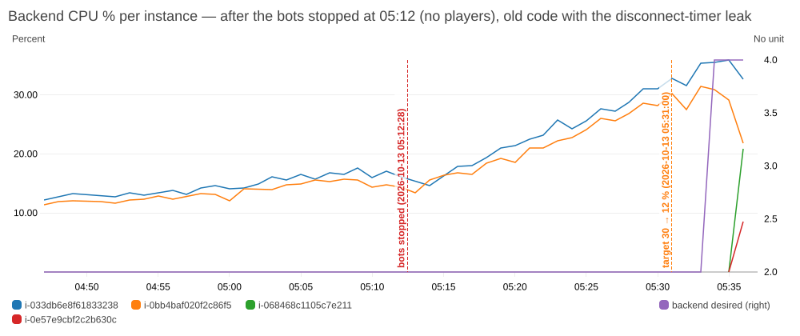

# Test4 Poker777 — 2,200 ผู้เล่น (เป้า) บน Backend 2 + Frontend 2 → เจอเพดานจริงของระบบ

**วันที่:** 13 ต.ค. 2026 เวลา 04:16–05:16 น. (เวลาไทย UTC+7) • **ระบบ:** `infra/terraform-test` — Frontend 2 + Backend 2 (t3.micro), Auto Scaling Backend min 2 / max 4 เป้า CPU 30 %, RDS writer + replica 3, Redis 2 node
**เครื่องมือ:** `aws-test.mjs --steps 2200 --minutes 10 --per-room 8 --browse-rps 1` • บอท 2,230 บัญชี
**โค้ดที่รัน:** commit `f6670a4` (ก่อนแก้บัคทั้ง 3 ตัวด้านล่าง)

> **สรุปเดียว:** ระบบตามเอกสาร Deploy รับได้ประมาณ **2,000 คน** แล้วล่ม — **ไม่ใช่เพราะ Backend** (CPU แค่ ~16 %) แต่เพราะ **nginx บน Frontend ตั้งค่าเริ่มต้นไว้รับได้ ~1,000 คน/เครื่อง** → health check ล้ม → Auto Scaling ปิด Frontend ทิ้งทีละเครื่อง → ผู้เล่นหลุดทั้งเครื่อง → หลุดต่อเนื่อง และหลังจากนั้น Backend เจอบัคตัวจับเวลาที่ทำให้ CPU พุ่งทั้งที่ไม่มีผู้เล่น — **แก้ทั้งหมดแล้ว ทดสอบซ้ำใน Test5**

## สิ่งที่เกิดขึ้นตามเวลา

| เวลา | เหตุการณ์ |
|---|---|
| 04:16 | เริ่ม • baseline Backend CPU 8.0 % (บัคตัวจับเวลาค้างจากเทสก่อน) |
| 04:17–05:03 | บอทเข้าโต๊ะทีละห้อง ~43 คน/นาที • CPU Backend 11 → 15 % |
| 05:03 | ผู้เล่น ~2,008 คน (251 ห้อง) — **การเชื่อมต่อแบ่งเท่ากันพอดี 1,001 / 1,002 ต่อ Backend** |
| **05:04:50** | **Frontend เครื่องที่ 1 ไม่ผ่าน health check → ASG ปิดทิ้ง** แล้วเปิดเครื่องใหม่ |
| 05:05 | ผู้เล่นบนเครื่องนั้นหลุด + ต่อใหม่พร้อมกัน → คำขอ 14,682/นาที, **ELB 5xx 13,664** |
| **05:08:45** | **Frontend เครื่องที่ 2 ล้มเหมือนกัน** → ปิดทิ้ง |
| 05:09–05:10 | ELB 5xx อีก 15,878 + 12,924 • สคริปต์บอทค้าง (บัคใน loadtest.mjs — แก้แล้ว) |
| 05:12:28 | หยุดบอท (ไม่มีผู้เล่นแล้ว) |
| 05:12–05:36 | **Backend CPU พุ่ง 16 → 34 % ทั้งที่ไม่มีผู้เล่น**, Node RAM 156 → 417 MB |
| 05:34 | (หลังลดเป้าเป็น 12 % เพื่อเตรียม Test5) Auto Scaling เพิ่ม Backend เป็น 4 เครื่องตามกฎ |

## ตัวเลขช่วงผู้เล่น ~2,000 คน (05:03:30–05:12:28)

| | ค่า |
|---|---|
| ผู้เล่นต่อ Backend (การเชื่อมต่อ :4000, `ss` ผ่าน SSM) | **1,001 / 1,002** |
| Backend CPU เฉลี่ย / สูงสุด | 15.7 / 17.6 % (เครื่องละ ~1,000 คน) |
| Node.js RAM | 156 / 154 MB (เครื่องเหลือว่าง ~480 MB) |
| Frontend CPU เฉลี่ย | 4.6 % (สูงสุด 22 % ช่วงต่อใหม่พร้อมกัน) |
| ALB connections เปิดค้าง | ~4,006 (2 ต่อผู้เล่น) |
| ELB 5xx | **43,907** (ทั้งหมดจากช่วง Frontend ล้ม) |
| RDS writer CPU / write latency | 6.7 % / 0.74 ms |
| Redis primary CPU | 12.5 % • network out 1,039 MB / 9 นาที |
| Latency ฝั่งบอท | ไม่มี — สคริปต์บอทค้างก่อนเริ่มพิมพ์สถิติ |

ไฟล์: `step1-2200bots/summary.md` (ตัวเลขช่วงด้านบน — แก้ช่วงวัดใน `summary.json` ด้วยมือ ดู `note`), `step1-2200bots/backend-sample-manual.txt`, `overall/` (กราฟทั้งเทส)

## ปัญหาที่ 1 — nginx บน Frontend รับได้ ~1,000 คนต่อเครื่อง (ต้นเหตุหลัก)

- `frontend.sh` ไม่ได้ตั้ง `worker_connections` → ใช้ค่าเริ่มต้นของ Amazon Linux **1024 ต่อ worker** × 2 worker (t3.micro 2 vCPU) = 2,048
- ผู้เล่น 1 คนผ่าน nginx ใช้ **2 การเชื่อมต่อ** (ฝั่งผู้เล่น + ฝั่ง Internal ALB) → **~1,000 คนต่อ Frontend ก็เต็ม**
- หลักฐาน: log ของ nginx `1024 worker_connections are not enough` **28,816 ครั้ง** • ASG activity: "taken out of service in response to an ELB system health check failure" ตอน 05:04:50 และ 05:08:45
- ผลลูกโซ่: เครื่องหนึ่งล้ม → ผู้เล่น ~1,000 คนไปต่อเครื่องที่เหลือ → เครื่องนั้นเต็มแล้วล้มต่อ (cascading failure)
- Test2 (Frontend เครื่องเดียว 1,000 คน) จึง **เฉียดเพดานมาก (~98 %)** — ผ่านมาได้พอดี
- **แก้ (`frontend/frontend.sh` `[แก้บัค]`, commit `b655465`):** `worker_connections 16384` + `worker_rlimit_nofile 65535` → AMI Frontend ของทีมต้องสร้างใหม่

## ปัญหาที่ 2 — Backend CPU พุ่งหลังผู้เล่นหลุดพร้อมกัน (บัคตัวจับเวลาตัวที่ 2)

- หลังหยุดบอท (ไม่มีผู้เล่นเลย) CPU ของ Backend **ขึ้นเรื่อยๆ** 16 → 34 % ใน 25 นาที, Node RAM 156 → 417 MB
- Redis: `poker:disconnect-timers` ค้าง **1,101 รายการ** ที่ครบเวลาแล้ว (`after-test-leak/redis-and-process.txt`) • log ของเครื่องเดียว: `Room is busy` **5,209 ครั้งใน 2 นาที**
- **สาเหตุ:** ทุก Backend อ่านรายการที่ครบเวลาชุดเดียวกัน เรียงเหมือนกัน ทุก 0.5 วิ แล้วแย่ง lock ห้องเดียวกัน → แทบไม่มีใครทำสำเร็จ + พิมพ์ error ยาวทุกครั้ง • **Auto Scaling ยิ่งเพิ่มเครื่องยิ่งแย่งกันหนัก** (positive feedback)
- เกิดกับระบบจริงได้ทุกครั้งที่ผู้เล่นหลุดพร้อมกันจำนวนมาก (Frontend ล้ม, deploy ใหม่, เน็ตของ AWS สะดุด)
- **แก้ (`ws-server.js` `[แก้บัค]`, commit `c4e1512`):** จองแต่ละรายการด้วย `SET NX PX` ก่อนทำ (เครื่องเดียวต่อรายการ), ทำทีละ ≤ 100, ไม่พิมพ์ `Room is busy` ของตัวจับเวลานี้
- **ยืนยันบน AWS แล้ว:** พอเปลี่ยน Backend เป็นโค้ดใหม่ (06:00) รายการค้าง 1,051 รายการถูกเคลียร์หมดภายในไม่กี่นาที, CPU ตอนว่างเหลือ 0.5–1 % (เดิม 6–8 %)

## ปัญหาที่ 3 — สคริปต์บอทค้าง (เครื่องมือเทส ไม่ใช่ระบบ)

บอทที่หลุดระหว่างกำลังเข้าห้องจะต่อใหม่ แต่ Promise ตัวเดิมไม่มีวัน resolve → การจัดโต๊ะหยุดที่ห้องที่ 252 • แก้ใน `tools/loadtest/loadtest.mjs`: ใช้ Promise เดิมตอนต่อใหม่ + ถ้า 30 วิยังนั่งไม่ได้ให้นับว่าล้มแล้วไปต่อ

## สรุปสำหรับรายงาน

| | ก่อนแก้ (Test4) | หลังแก้ |
|---|---|---|
| ผู้เล่นสูงสุดที่ระบบรับได้ | **~2,000** (Frontend 2 × ~1,000) | ดู Test5 |
| สิ่งที่ตันก่อน | nginx `worker_connections` บน Frontend | — |
| Backend CPU ที่ 2,000 คน | ~16 % ต่อเครื่อง (ยังเหลืออีกมาก) | — |
| CPU ตอนว่างหลังผู้เล่นหลุดพร้อมกัน | 34 % และขึ้นเรื่อยๆ | ~1 % |

**บทเรียน:** การทดสอบที่ระดับ 1,000 คน (Test1–3) ไม่เห็นปัญหาทั้งสองเลย — ต้องทดสอบเกินจุดที่คิดว่าเป็นคอขวด (Backend CPU) จึงเจอคอขวดจริง (การตั้งค่า nginx) และบัคที่เกิดเฉพาะตอนระบบล้ม

## ข้อจำกัด
1. ไม่มี latency ฝั่งบอท (สคริปต์ค้างก่อนพิมพ์สถิติ) • ช่วงวัดตั้งเองจาก log (05:03:30–05:12:28)
2. บอทยิงจากคอมเครื่องเดียวในไทย
3. หลังเทสมีการลดเป้า Auto Scaling เป็น 12 % (เตรียม Test5) → Backend 4 เครื่องตอน 05:34 ไม่ใช่ผลของ Test4 โดยตรง แต่เป็นผลของบัคข้อ 2 ที่ทำให้ CPU เกินเป้า

## ไฟล์
`summary.json` • `results.csv` • `asg-timeline.csv` • `overall/` • `step0-baseline/` • `step1-2200bots/` • `after-test-leak/` (กราฟ CPU หลังหยุดบอท + จำนวนรายการค้างใน Redis)
