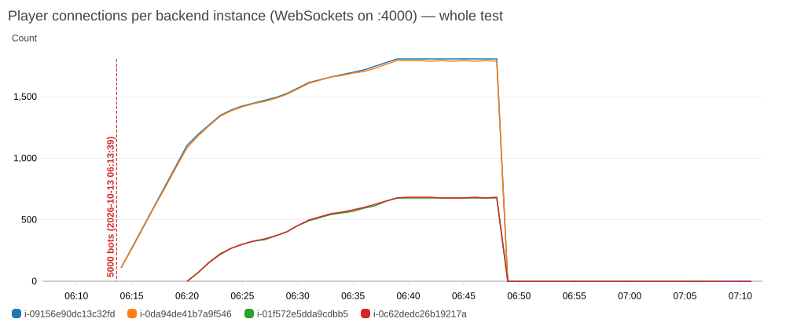

# Test5 Poker777 — 5,000 ผู้เล่น + Auto Scaling (Backend 2 → 4 → 2)

**วันที่:** 13 ต.ค. 2026 เวลา 06:13–07:12 น. (เวลาไทย UTC+7) • **ระบบ:** `infra/terraform-test` — Frontend 2 + Backend min 2 / max 4 (t3.micro), RDS writer + replica 3, Redis 2 node
**โค้ด:** commit `c4e1512` — แก้ nginx `worker_connections` (Frontend) + แก้บัคตัวจับเวลาหลุดการเชื่อมต่อ 2 ตัว (ผลจาก Test4)
**Auto Scaling:** target tracking `ASGAverageCPUUtilization` **12 %** (ลดจาก 30 % เพื่อให้เห็นการเพิ่มเครื่องในการทดสอบ), warmup 180 s
**เครื่องมือ:** `aws-test.mjs --steps 5000 --minutes 10 --per-room 8 --browse-rps 1 --seat-parallel 6 --observe-after 20` • บอท 5,000 บัญชี (2,770 สร้างตรงใน DB ทดสอบด้วย `--seed-bots`) • นับผู้เล่นต่อเครื่องทุก 1 นาที (`players-per-instance.csv`, กราฟ 16)

> **ผลหลังแก้บัคข้อ 4: ดู `../Test6-Poker777/README.md`** — 5,000 คน latency p50 296 / p95 410 ms, เกมเดินเร็วขึ้น 4.5 เท่า

## สรุปสั้น

| คำถาม | คำตอบ |
|---|---|
| **รับ 5,000 คนได้ไหม?** | **ได้** — นั่ง 4,947 / 5,000 (53 ตัวเข้าห้องไม่ทันใน 30 วิช่วงคนเข้าพร้อมกัน), **หลุด 0, 5xx 0**, เล่น 13,432 มือ • Test4 ระบบล้มที่ ~2,000 คน → **การแก้ nginx ใช้ได้จริง** (Frontend เครื่องละ ~2,500 คน CPU แค่ 3 %) |
| **Auto Scaling ทำงานดีไหม?** | **ดี** — CPU เกินเป้า → 06:19 สั่งเพิ่ม **2 → 4 ในครั้งเดียว** (ตอนมี ~1,860 คน), เครื่องใหม่รับผู้เล่นได้ใน ~2 นาที • หลังผู้เล่นออกหมด ~15 นาที ลด **4 → 3 → 2** (07:06–07:07) ครบวงจร ไม่ค้าง |
| **กระจายผู้เล่นดีไหม?** | **คนที่เข้ามาใหม่กระจายเท่ากันทุกเครื่อง** (หลัง 06:21 ทุกเครื่องได้เพิ่ม ~700 คนเท่ากัน) แต่ **คนที่ต่ออยู่แล้วไม่ย้าย** (WebSocket ค้างกับเครื่องเดิม) → ตอนจบ **1,805 / 1,792 / 676 / 681** |
| **ผู้เล่นรู้สึกยังไง?** | **ช้า** — latency p50 1.3 วิ / p95 8.3 วิ ทั้งที่ CPU ทุกเครื่อง ≤ 15 % → ไม่ใช่เครื่องไม่พอ แต่เป็น **บัคแย่ง lock ของตัวจับเวลา** (ข้อ 4) — **แก้แล้ว (commit `e06df8e`) รอ deploy + ทดสอบซ้ำ** |
| **ส่วนอื่น** | RDS writer CPU ≤ 10 %, write latency 0.70 ms • Redis 13–14 % • RAM Node.js 130–140 MB/เครื่อง • ALB เชื่อมต่อค้าง ~9,900 |

## ไทม์ไลน์

| เวลา | ผู้เล่น | Backend | เหตุการณ์ |
|---|---|---|---|
| 06:08–06:13 | 0 | 2 | baseline: CPU **0.5 %**, RAM 93 MB (Test4: 8 % / 131 MB → แก้บัคแล้วตอนว่างแทบไม่ใช้อะไร) |
| 06:13 | → | 2 | เริ่มจัดผู้เล่น ~330 คน/นาที (6 ห้องพร้อมกัน) |
| 06:15–06:18 | 541 → 1,530 | 2 | CPU 2 เครื่องขึ้นถึง ~30 % (ช่วงคนเข้าพร้อมกัน) → เกินเป้า 12 % ติดกัน 3 นาที |
| **06:19:18** | 1,858 | **desired 2 → 4** | target tracking คำนวณว่าต้องใช้ 4 เครื่องในครั้งเดียว (CPU ~25 % ÷ 12 % ≈ ×2) |
| 06:20–06:21 | 2,190 → 2,513 | **4** | เครื่องใหม่ผ่าน health check เริ่มรับผู้เล่น (~2 นาทีหลังสั่ง) |
| 06:22 | 2,842 | 4 | CPU เครื่องเดิม 33 % → 14 % ในนาทีเดียว |
| 06:38–06:39 | 4,947 | 4 | นั่งครบ — เริ่มเล่น 10 นาที |
| 06:39–06:49 | 4,953 | 4 | CPU 13–14 % (เดิม) / 10–11 % (ใหม่) • 0 หลุด • 0 5xx |
| 06:49 | 0 | 4 | บอทออกหมด |
| **07:06 / 07:07** | 0 | **4 → 3 → 2** | ลดเครื่องหลัง CPU ต่ำกว่าเป้า ~15 นาที (ค่าเริ่มต้นของ target tracking) |

## ผลรายละเอียด

| | ค่า |
|---|---|
| นั่งได้ / มือ / การกระทำ | 4,947 / 5,000 • 13,432 มือ • 121,183 action |
| Latency เกม p50 / p95 / p99 / max | **1,317 / 8,328 / 13,768 / 35,914 ms** (ค่าสะสมตั้งแต่มือแรก — ตอนเริ่มเล่น 06:39 p50 = 407 ms แล้วขึ้นเรื่อยๆ = ช่วงเล่นเต็มช้ากว่าช่วงจัดโต๊ะ) |
| หน้ารายชื่อห้อง/ประวัติ (REST) p50 / p95 | 348 / 595 ms (Test3: ~260 / 310) — `/tables` ส่งคืน **ทุกห้อง** (625 ห้อง) + อ่าน Redis ห้องละครั้ง → ช้าตามจำนวนห้อง (ข้อ 5) |
| ALB (เวลาใน AWS) p50 / p95 | 144 / 516 ms (= คำขอ `/tables` เป็นหลัก) |
| หลุด / 5xx / 4xx | **0 / 0 / 0** |
| Backend CPU เฉลี่ย / สูงสุด (ทั้งกลุ่ม) | 11.6 / 13.8 % |
| Frontend CPU | 3.0 % (เครื่องละ ~2,500 คน) |
| RAM Node.js (กลางช่วงเล่น) | 140 / 139 / 131 / 130 MB — เหลือว่าง ~480–500 MB/เครื่อง |
| RDS writer CPU / connections / write IOPS / latency | 8.4 % (สูงสุด 10 %) / 45 / 193 / 0.70 ms |
| Replica CPU | ≤ 7.6 % • lag ≤ 1 s |
| Redis primary CPU / network out | 13–14 % / 1.9 GB ใน 10 นาที |
| ขนาดข้อมูล | hand_results +45,976 แถว (+11.6 MB), transactions +43,829 (+13.7 MB) → **0.55 KB / ผู้เล่น / มือ** (สอดคล้อง Test2–3) |

## อ่านผลทีละส่วน

### 1. Auto Scaling (ตอบโจทย์หลักของ Test5)
- **ตัดสินใจถูก:** CPU เกินเป้านาน 3 นาที → เพิ่มเครื่องทันที และ **เพิ่มทีเดียว 2 เครื่อง** (target tracking คำนวณจำนวนที่ต้องใช้ ไม่ได้เพิ่มทีละ 1)
- **เร็ว:** สั่ง 06:19:18 → เครื่องใหม่รับผู้เล่นได้ 06:21 (~2 นาที รวม boot + ติดตั้ง + health check)
- **ได้ผล:** CPU เครื่องเดิมลด 33 % → 14 % ภายในนาทีเดียวหลังเครื่องใหม่เข้า
- **ลดเครื่องเองได้:** ไม่มีผู้เล่น ~15 นาที → 4 → 3 → 2 (ไม่ต่ำกว่า min) • ไม่มีเครื่องค้าง/ล้ม
- เป้า 12 % ใช้เพื่อการทดสอบ — ใช้จริงแนะนำ **25–30 %** (Node.js ใช้ 1 core = 50 % เต็ม)

### 2. การกระจายผู้เล่น (กราฟ 16)

| ช่วง | เครื่องเดิม A / B | เครื่องใหม่ C / D |
|---|---|---|
| 06:20 (ก่อนเครื่องใหม่รับงาน) | 1,102 / 1,088 | 0 / 0 |
| 06:21 → 06:39 ได้เพิ่ม | **+703 / +704** | **+676 / +681** |
| ตอนเล่น (06:39–06:48) | **1,805 / 1,792** | **676 / 681** |

- **ALB (round robin) แบ่งคนเข้าใหม่เท่ากันทุกเครื่องจริง** (+~700 ทุกเครื่อง) และสองเครื่องที่เริ่มพร้อมกันได้เท่ากันแทบทุกนาที (ต่างกัน ≤ 1 %)
- แต่ **WebSocket ของคนที่ต่ออยู่แล้วไม่ย้ายไปเครื่องใหม่** → เครื่องเดิมถือมากกว่า ~2.7 เท่าตลอดเกม (CPU 13–14 % vs 10–11 %)
- ทางแก้ (เสนอ): ตั้ง target group เป็น **`least_outstanding_requests`** — WebSocket นับเป็นคำขอค้าง → คนใหม่ไปเครื่องที่ว่างกว่าก่อนจนเท่ากัน (ยังไม่ได้ทดสอบ)
- ผู้เล่นโต๊ะเดียวกันอยู่ต่างเครื่องได้ — สถานะโต๊ะอยู่ใน Redis และกระจายผ่าน pub/sub (เล่นได้ 13,432 มือ ไม่มี error สถานะไม่ตรงกัน)

### 3. ความจุ (เทียบทุกเทส)

| เทส | ผู้เล่น | Backend | Frontend | ผล |
|---|---|---|---|---|
| Test2 | 1,000 | 1 (24.6 %) | 1 | ผ่าน (Frontend เกือบเต็ม ~98 %) |
| Test3 | 1,000 | 2 (19 / 15 %) | 2 | ผ่าน |
| Test4 | ~2,000 | 2 (16 %) | 2 | **ล้ม** — nginx Frontend เต็ม |
| **Test5** | **4,947** | **2 → 4** (14 / 14 / 11 / 11 %) | 2 (3 %) | **ผ่าน ไม่มีใครหลุด แต่ latency สูง (บัคข้อ 4)** |

→ หลังแก้ nginx: **5,000 คนบนเครื่อง t3.micro 6 เครื่อง โดย CPU ยังเหลือเยอะทุกตัว** — ข้อจำกัดตอนนี้ไม่ใช่ทรัพยากร แต่เป็นการแย่ง lock ในโค้ด

### 4. ทำไม latency สูง ทั้งที่ CPU ต่ำ — บัคตัวที่ 3 (แก้แล้ว รอ deploy)
- log Backend: `[AutoStart] Room is busy` **~850 ครั้ง/นาที/เครื่อง** • บอทโดน `Room is busy` 3,053 ครั้ง, `Not your turn` 2,636 ครั้ง (ตาหมดเวลาระหว่างรอ)
- สาเหตุ: ตัวจับเวลาเริ่มมือ / หมดเวลาตา / หลุดการเชื่อมต่อ ถูกเรียกทุก 0.5 วิ **โดยไม่รอรอบก่อนจบ** และ **รอ lock ห้องได้ถึง ~2 วิ** → รอบซ้อนกันหลายชั้น × 4 เครื่องที่ทำรายการเดียวกัน → Action ของผู้เล่นต้องต่อคิว lock หลังงานพวกนี้ • ยิ่งห้องเยอะ (625) และเครื่องเยอะ (4) ยิ่งหนัก
- แก้ (`e06df8e`, `ws-server.js` + `lockService.js`): ทีละรอบต่อเครื่อง, จองรายการด้วย `SET NX PX`, ตัวจับเวลาลอง lock ครั้งเดียว (ผู้เล่นยังรอได้), ทีละ ≤ 100 รายการ • ทดสอบในเครื่องผ่าน • **ต้อง push + เปลี่ยนเครื่อง แล้วทดสอบ 5,000 คนซ้ำ (Test6) เพื่อวัด latency หลังแก้**

### 5. ข้อสังเกตอื่น
- `GET /tables` คืนห้อง OPEN ทั้งหมด (625 ห้อง) + นับที่นั่งจาก Redis ห้องละครั้ง → p95 ~0.5 วิ ตอนห้องเยอะ — ควรแบ่งหน้า (LIMIT) หรือ cache
- Redis network out ~190 MB/นาที (pub/sub ส่งทุกเหตุการณ์ให้ทุก Backend) — cache.t3.micro ยังรับได้ แต่โตตาม (ผู้เล่น × จำนวน Backend)
- Writer connections 45 (4 เครื่อง × pool) — db.t4g.micro รับได้ ~80 → ถ้าขยายเกิน 6–7 Backend ต้องใช้ RDS Proxy (มีอยู่แล้วแต่ยังไม่ได้ใช้) หรือลด pool

## กราฟที่แนะนำให้ใส่รายงาน

| ไฟล์ | ใช้ตอบ |
|---|---|
| `overall/14-asg-instances.png` | **Auto Scaling 2 → 4 → 2** ตามเวลา |
| `overall/16-players-per-instance.png` | **ผู้เล่นต่อเครื่อง** — คนใหม่กระจายเท่ากัน / คนเก่าไม่ย้าย |
| `overall/15-backend-cpu-per-instance.png` | CPU เครื่องเดิมลดทันทีที่เครื่องใหม่เข้า, ทุกเครื่อง ≤ 15 % ตอนเล่น |
| `overall/03-alb-connections.png` | การเชื่อมต่อ ~9,900 (5,000 ผู้เล่น) ไม่มีหลุด |
| `overall/02-alb-requests-errors.png` | 5xx = 0 (เทียบกับ Test4 ที่ 43,907) |
| `players-per-instance.csv`, `asg-timeline.csv` | ทำกราฟเองใน Excel |

ถ้าจะแคปจาก CloudWatch Console เอง: Dashboard `poker777-prod-loadtest` → Custom → Absolute → **06:05–07:15** (Local timezone) → "Instances in each Auto Scaling Group", "CPU % per EC2 instance" — กราฟผู้เล่นต่อเครื่องเป็น custom metric `Poker777/LoadTest › PlayerConnections` (เพิ่มใน Console เองได้)

## ข้อจำกัด
1. บอทยิงจากคอมเครื่องเดียวในไทย (~260 ms) • เข้าห้อง 6 ห้องพร้อมกัน → ช่วงแรกเป็น join storm หนักกว่าการใช้งานจริง
2. Latency ของบอทเป็นค่าสะสม (รวมช่วงจัดโต๊ะ) — ไม่มีค่าเฉพาะช่วงเล่น แต่ p50 ขึ้นจาก 407 → 1,317 ms ระหว่างเล่น = ช่วงเล่นช้ากว่า
3. เป้า Auto Scaling 12 % ต่ำกว่าที่ควรใช้จริง (ตั้งเพื่อให้เห็นการ scale ในเวลาทดสอบ)
4. บัญชีบอท 2,770 ตัวสร้างตรงใน DB (ข้ามการสมัคร) — ไม่ได้วัดความเร็วการสมัคร

## ไฟล์
`summary.json` • `results.csv` • `asg-timeline.csv` • `players-per-instance.csv` • `overall/` (16 กราฟ ทั้งเทส + ช่วงลดเครื่อง) • `step0-baseline/` • `step1-5000bots/` (`summary.md`, `timeseries.csv`, `bots.log`, `bots-timeline.csv`, `backend-sample.txt` 4 เครื่อง)
